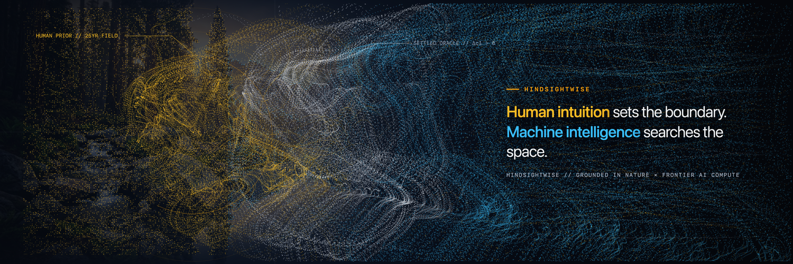

# Robert Zerby — HindsightWise

> **Dad, fuel technician, systems operator. Building together with AI—I bring the real-world common sense and direction, it brings the code.**

25+ years of high-consequence physical systems operations, regulatory compliance, and mechanical root-cause diagnostics across 80+ Southern California fuel infrastructure sites—now applied to **Human–AI collaborative systems engineering, multi-stage verification gates, and orthogonal red-team harnesses**.

---

### How We Work Together (Human + AI Division of Labor)

Every repository here is built through a transparent partnership between a veteran physical-systems operator and frontier AI models:
- **What I Bring**: Real-world common sense, problem selection, failure-mode intuition from decades of diagnosing pressurized mechanical/electrical systems, and pushing back when an implementation drifts or cuts corners.
- **What the AI Brings**: Formal mathematical synthesis, rapid code generation across Python/Rust/TypeScript, and automated test harnesses.

---

### Public Engineering Projects

| Repository | Focus |
| :--- | :--- |
| [**`sovereign-oversight-harness`**](https://github.com/HindsightWise/sovereign-oversight-harness) | Dual-gated verification harness (`Plan Gate` + `Deliverable Gate`), Reset-Aware Settled-State Oracle (`Δc1` regeneration control), and append-only episodic memory ledger. |
| [**`orthogonal-redteam-harness`**](https://github.com/HindsightWise/orthogonal-redteam-harness) | Cross-family adversarial verification routing plans and code to an orthogonal critic model on ephemeral GPU compute with zero-idle auto-unassign. |
| [**`mlx-code-surgeon`**](https://github.com/HindsightWise/mlx-code-surgeon) | Local Apple Silicon Metal unified-memory code infilling (FIM) and schema formatting server with strict `<5 GB` memory ceiling guards. |
| [**`teleos-consensus-engine`**](https://github.com/HindsightWise/teleos-consensus-engine) | Multi-probe signal ingestion and TF-IDF bigram graph clustering engine requiring cross-cohort consensus before promoting operational pain points. |

---

- **X**: [@Zerbytheboss](https://x.com/Zerbytheboss)
- **LinkedIn**: [Robert Zerby](https://www.linkedin.com/in/robert-zerby-49520596/)
